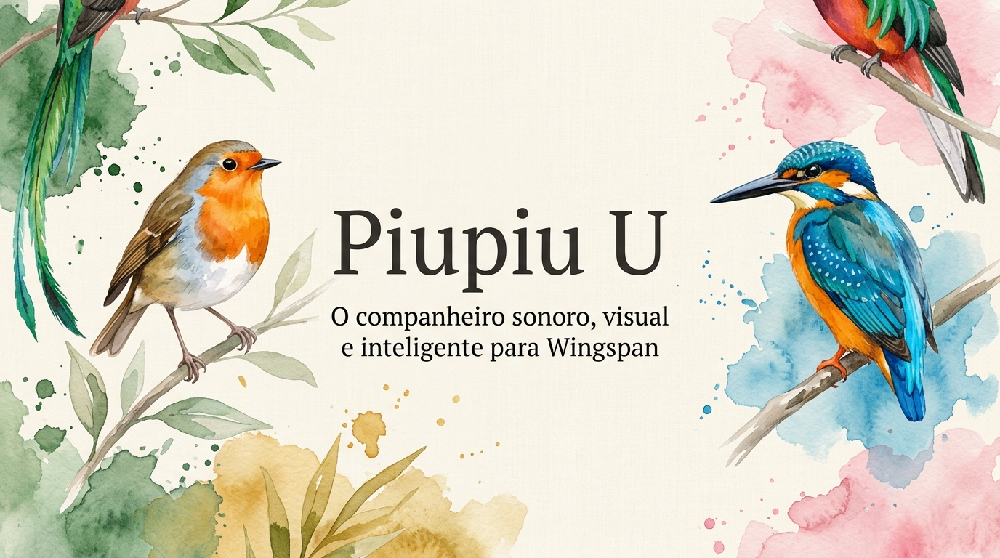
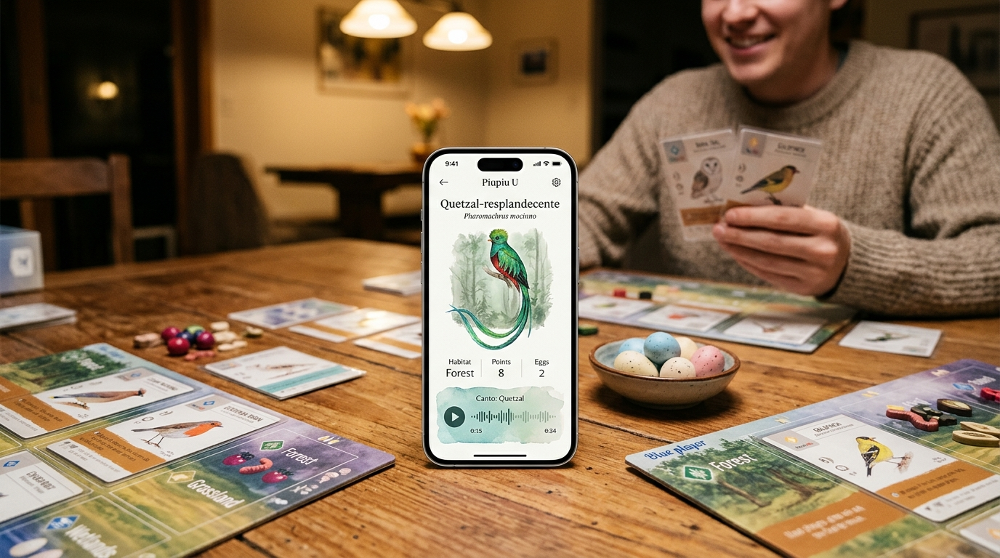
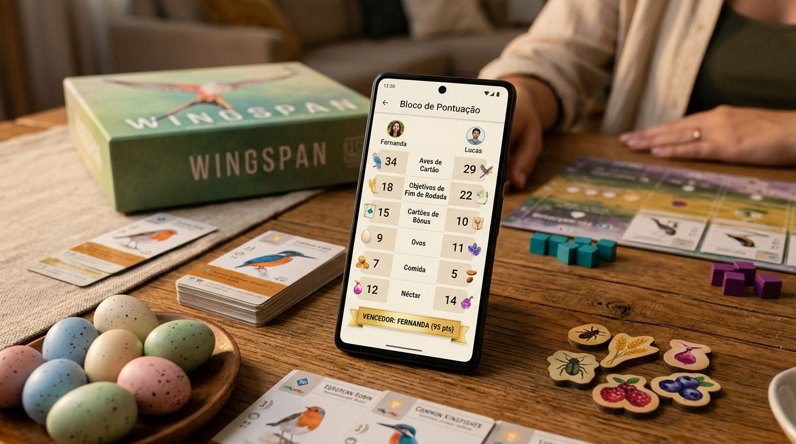

<div align="center">

# 🪶 Piupiu U
### O Guia Sonoro, Visual e Inteligente para *Wingspan*



**Dê asas à sua noite de jogos com o companheiro de mesa definitivo para os amantes de Wingspan.**

[](https://stonemaiergames.com/games/wingspan/)
[](https://stonemaiergames.com/games/wingspan/)
[](https://www.inaturalist.org/)
[](https://expo.dev/)

[Visão Geral](#-por-que-o-piupiu-u) • [Funcionalidades](#-principais-funcionalidades) • [O Jogo na Mesa](#-em-ação-na-sua-mesa) • [Expansões](#-todas-as-5-expansões-oficiais) • [Perguntas Frequentes](#-perguntas-frequentes) • [Como Usar](#-como-experimentar)

---

</div>

## 🌿 Por que o Piupiu U?

Quem joga **Wingspan** conhece a sensação mágica de admirar cada ilustração botânica, planejar os habitats e construir um refúgio ecológico perfeito. Mas algo sempre fez falta na mesa: **como soa esse pássaro na natureza?**

Inspirado no lendário e saudoso aplicativo *Wingsong*, o **Piupiu U** nasceu para transformar cada partida em uma experiência viva:
- Você joga uma carta na mesa...
- Tira uma foto ou busca pelo nome em segundos...
- E a sua sala de jogos é preenchida pelo **canto real e autêntico** daquela ave gravado em seu habitat natural.

Tudo isso envolto em uma estética artesanal inspirada no próprio tabuleiro: papel linho natural, manchas de aquarela orgânica e muito carinho aos detalhes ornitológicos.

---

## ✨ Principais Funcionalidades

### 📸 1. Scanner de Mesa Rápido e Preciso
> **Aponte, fotografe e ouça. Sem precisar digitar nada na pressa do seu turno.**

- **Feito para jogar à noite**: Reconhece o título da carta mesmo com iluminação suave de sala de estar ou reflexos de *sleeves* plásticos de proteção.
- **Controles de Zoom na Câmera**: Alterne entre `1x`, `1.5x Ideal`, `2x` e `Macro` para focar a carta a 15–20 cm da mesa sem tremedeira.
- **Tolerante e Rápido**: Encontra a ave certa mesmo se a carta estiver levemente inclinada.

---

### 🎵 2. Cantos Ornitológicos 100% Reais
> **Zero bipes sintéticos de computador. Natureza de verdade na sua mesa.**

- **Gravações Científicas Autênticas**: Áudios de campo capturados por pesquisadores e biólogos em todo o planeta, através das bases abertas do **iNaturalist** e **Xeno-Canto**.
- **Sem Cacofonia na Mesa**: Sistema inteligente de áudio exclusivo — quando você troca de carta ou reproduz um novo canto, o som anterior para imediatamente, garantindo que o som nunca fique embolado.

---

### 🦜 3. O Toque de Humor: Bordão "Piu Piu!"
> **Uma pitada cômica que arranca sorrisos na mesa de jogo.**

- Ao abrir ou fotografar qualquer carta, o aplicativo anuncia a ave de forma descontraída com um sintetizador vocal calibrado em português:
  > *"piu! piu! Quetzal-resplandecente... Pharomachrus mocinno."*
- Todo mundo na mesa descobre na hora a ave que você baixou, com direito a piados bem-humorados antes do nome científico em latim!
- Você pode repetir o anúncio ou silenciar a qualquer momento com um simples toque.

---

### 🖼️ 4. Arte Viva & Fotografias da Vida Selvagem
> **A ilustração ganha movimento e você pode ver a ave como ela realmente é.**

- **Tecnologia Living Card**: Graças ao motor gráfico acelerado na GPU, as ilustrações ganham respiração suave, reflexo acetinado nas penas e partículas de atmosfera (folhas na Floresta, pólen no Campo e névoa na Água).
- **Paralaxe 2.5D**: Ao movimentar o celular nas mãos, a arte ganha sensação óptica de profundidade.
- **Fotos em Alta Resolução**: Toque na foto para abrir o modo de **Zoom em Tela Cheia** e admirar cada detalhe da plumagem real da espécie.

---

### 📝 5. Bloco de Pontuação Digital para 2 Jogadores
> **Chega de gastar bloquinhos de papel ou errar contas de cabeça no final da partida!**

- **Tabela Única & Sem Complicação**: Todas as categorias oficiais do jogo em uma única tela limpa e elegante.
- **Soma Instantânea em Tempo Real**: Conforme você digita os números, os totais dos dois jogadores recalculam sozinhos na mesma hora.
- **Suporte Oficial a Todas as Expansões**:
  - Pontuação de **Beija-flores** (Expansão Américas)
  - Pontuação de **Néctar** (Expansão Oceania)
  - Pontuação da **Trilha do Modo Duo** (Expansão Ásia)
- **Indicador de Vencedor**: Mostra quem está na frente e a diferença de pontos com um banner comemorativo dourado.
- Não jogou com alguma expansão? É só deixar o campo em branco ou `0` — ele soma zero pontos sem exigir menus chatos ou configurações prévias.

---

### 📚 6. Enciclopédia Completa das 597 Aves Oficiais
> **Todas as aves já lançadas no universo de Wingspan reunidas no seu bolso.**

- **Busca Trilíngue Ultrarrápida**: Pesquise instantaneamente pelo nome em **Português**, **Inglês** ou pelo **Nome Científico em Latim**.
- **Filtros por Habitat e Expansão**: Encontre qualquer ave da Floresta, Campo ou Água em menos de 100 milissegundos.
- **Funciona 100% Offline para os Dados**: Você nunca fica na mão se a internet da casa de campo ou da chácara falhar durante a partida.

---

## 🎲 Em Ação na sua Mesa

<div align="center">

| Canto e Arte da Ave Durante a Partida | Pontuação Final Descomplicada |
| :---: | :---: |
|  |  |
| *Identifique e ouça o canto real no meio da partida com componentes na mesa.* | *Some pontos do jogo base, néctar, beija-flores e modo duo na hora.* |

</div>

---

## 🗺️ Todas as 5 Expansões Oficiais

O Piupiu U inclui o acervo ornitológico completo de todas as expansões lançadas mundialmente pela **Stonemaier Games** e publicadas no Brasil pela **Grok Games**:

| Expansão | Aves | Destaques no Aplicativo | Cor da Aquarela |
| :--- | :---: | :--- | :---: |
| **Jogo Base** | 180 | As espécies clássicas da América do Norte | 🔵 Azul Ardósia |
| **Europa** | 81 | Poderes de fim de rodada e aves icônicas europeias | 🟣 Azul Cobalto |
| **Oceania** | 95 | Aves australianas, neozelandesas e pontuação de **Néctar** | 🟠 Pôr-do-sol Terracota |
| **Ásia** | 90 | Aves asiáticas e pontuação da **Trilha do Modo Duo** | 🔴 Flor de Cerejeira |
| **Américas** | 151 | Todas as aves sul-americanas + os **40 Beija-flores** | 🟢 Verde Esmeralda |

---

## 🎨 Design Inspirado no Jogo Físico

O Piupiu U foi desenhado como se fosse uma página do diário de campo de um naturalista do século XIX:

- **Papel Linho Natural (`#F5F0E6`)**: O mesmo tom aconchegante dos tabuleiros físicos de *Wingspan*, suave para os olhos em partidas noturnas.
- **Gotas Orgânicas de Aquarela**: Ícones criados com formato assimétrico de tinta fluida sobre papel prensado a frio, com acúmulo de pigmento nas bordas e halos suaves de água.
- **Tipografia Serifada Clássica**: Nomes de aves e termos taxonômicos diagramados com a nobreza de livros de ornitologia clássica.

---

## 💬 Perguntas Frequentes

<details>
<summary><b>1. O aplicativo precisa de conexão com a internet?</b></summary>
<br>
O catálogo com todas as 597 aves, a busca, as ilustrações, o bloco de pontuação e os cálculos funcionam <b>100% offline</b>. Para tocar o canto ornitológico real ou ver a fotografia da espécie pela primeira vez, o app faz o streaming pela internet e armazena em cache na memória do aparelho.
</details>

<details>
<summary><b>2. O aplicativo é pesado para baixar?</b></summary>
<br>
Não! O Piupiu U é incrivelmente leve (apenas alguns megabytes). Ele não embutiu centenas de arquivos pesados de áudio no download do instalador, garantindo downloads instantâneos e respeito ao armazenamento do seu celular.
</details>

<details>
<summary><b>3. Funciona em celulares Android e iPhone?</b></summary>
<br>
Sim! O Piupiu U foi desenvolvido para ser multiplataforma, rodando perfeitamente tanto no <b>Android</b> quanto no <b>iOS (iPhone e iPad)</b>, além de contar com suporte no <b>Navegador Web</b>.
</details>

<details>
<summary><b>4. Há anúncios ou compras dentro do app?</b></summary>
<br>
Não! O projeto é 100% livre de anúncios, focado exclusivamente em enriquecer a experiência ao redor da mesa de jogo.
</details>

---

## 🚀 Como Experimentar

### Para Jogadores (Via Expo Go no Celular)
Se você possui o aplicativo gratuito **Expo Go** instalado no seu Android ou iPhone:
1. Abra o Expo Go no seu smartphone.
2. Escaneie o QR Code do projeto ou abra a versão de prévia diretamente no seu aparelho.

---

<details>
<summary><b>🛠️ Informações Técnicas para Desenvolvedores</b></summary>
<br>

Desenvolvido com **React Native**, **TypeScript** e **Expo SDK 58**:

```bash
# 1. Instalar dependências
npm install

# 2. Configurar variáveis de ambiente
cp .env.example .env

# 3. Iniciar o servidor de desenvolvimento
npm start

# 4. Executar suíte de testes unitários (82 testes passando)
npm test

# 5. Checagem estrita de tipos TypeScript
npm run typecheck
```

- **Motor Gráfico 2D**: `@shopify/react-native-skia`
- **Motor de Busca**: `Fuse.js` (tolerância a erros ortográficos e acentos)
- **Leitura de Imagem (OCR)**: `expo-camera` + `Tesseract.js`
- **Áudio**: `expo-audio` + APIs abertas do iNaturalist & Xeno-Canto
- **Voz TTS**: `expo-speech` em Português do Brasil com prosódia cômica

</details>

---

<div align="center">

**Feito com amor por pássaros, jogos de tabuleiro e boa música ornitológica.**  
*Wingspan é uma criação de Elizabeth Hargrave e Stonemaier Games. Este projeto é um companheiro não-oficial de código aberto dedicado à comunidade de jogadores.*

🪶 **Boa partida e bons piados!**

</div>
