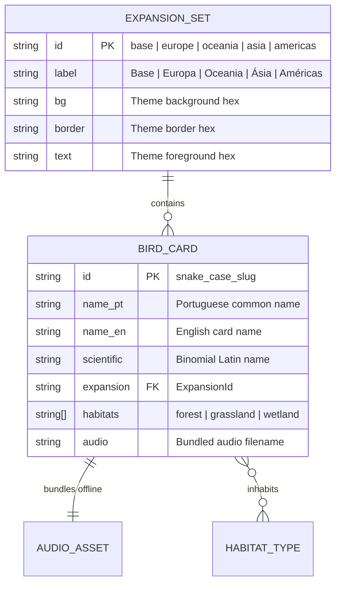

# Phase 1 Data Model: Complete Wingspan Bird Catalog & All Expansions

**Feature**: `001-complete-bird-catalog`
**Date**: 2026-10-28

---

## Entities

### 1. `ExpansionId` (Enum / Union Type)

Represents the five official *Wingspan* sets supported by PiaPiuPiu:

| Value | Display Label (PT-BR) | Card Count | Description |
|-------|-----------------------|------------|-------------|
| `'base'` | `Base` | 180 | Core North America box (170) + Swift-Start pack (10) |
| `'europe'` | `Europa` | 81 | European Expansion |
| `'oceania'` | `Oceania` | 95 | Oceania Expansion |
| `'asia'` | `Ásia` | 90 | Asia Expansion / Standalone Flock & Duet |
| `'americas'` | `Américas` | 151 | Americas Expansion (111 standard bird cards + 40 hummingbird cards) |

---

### 2. `BirdCard` (Core Catalog Entity)

Stored in `src/data/birds-seed.json` (source metadata) and `src/data/birds.json` (synced runtime catalog).

| Field | Type | Required | Constraints & Validation Rules |
|-------|------|----------|--------------------------------|
| `id` | `string` | Yes | Unique across catalog; matches `/^[a-z0-9_]+$/` (derived from `name_en` or `scientific` slug). |
| `name_pt` | `string` | Yes | Non-empty Brazilian Portuguese common name (e.g., `"Tucano-toco"`). |
| `name_en` | `string` | Yes | Non-empty official English card title (e.g., `"Toco Toucan"`). |
| `scientific` | `string` | Yes | Binomial scientific name printed on card (e.g., `"Ramphastos toco"`). |
| `expansion` | `ExpansionId` | Yes | One of `'base' \| 'europe' \| 'oceania' \| 'asia' \| 'americas'`. |
| `habitats` | `HabitatType[]` | Yes | Non-empty subset of `['forest', 'grassland', 'wetland']`. |
| `audio` | `string` | Yes (in `birds.json`) | Safe filename `<id>.<mp3\|opus>` inside `assets/audio/`. |
| `source` | `string` | Optional | Provenance tag (`"xeno-canto:<id>"`, `"inaturalist:<id>"`, or `"synthesized-offline"`). |

---

### 3. `BIRD_AUDIO_ASSETS` (Static Bundler Lookup Map)

Auto-generated in `src/data/audioMap.ts` by `scripts/sync-birds.mjs`:

```ts
export const BIRD_AUDIO_ASSETS: Record<string, number> = {
  abbotts_booby: require('../../assets/audio/abbotts_booby.mp3'),
  acorn_woodpecker: require('../../assets/audio/acorn_woodpecker.mp3'),
  // ... all 597 birds
};
```

---

## Relationships & State Transitions



