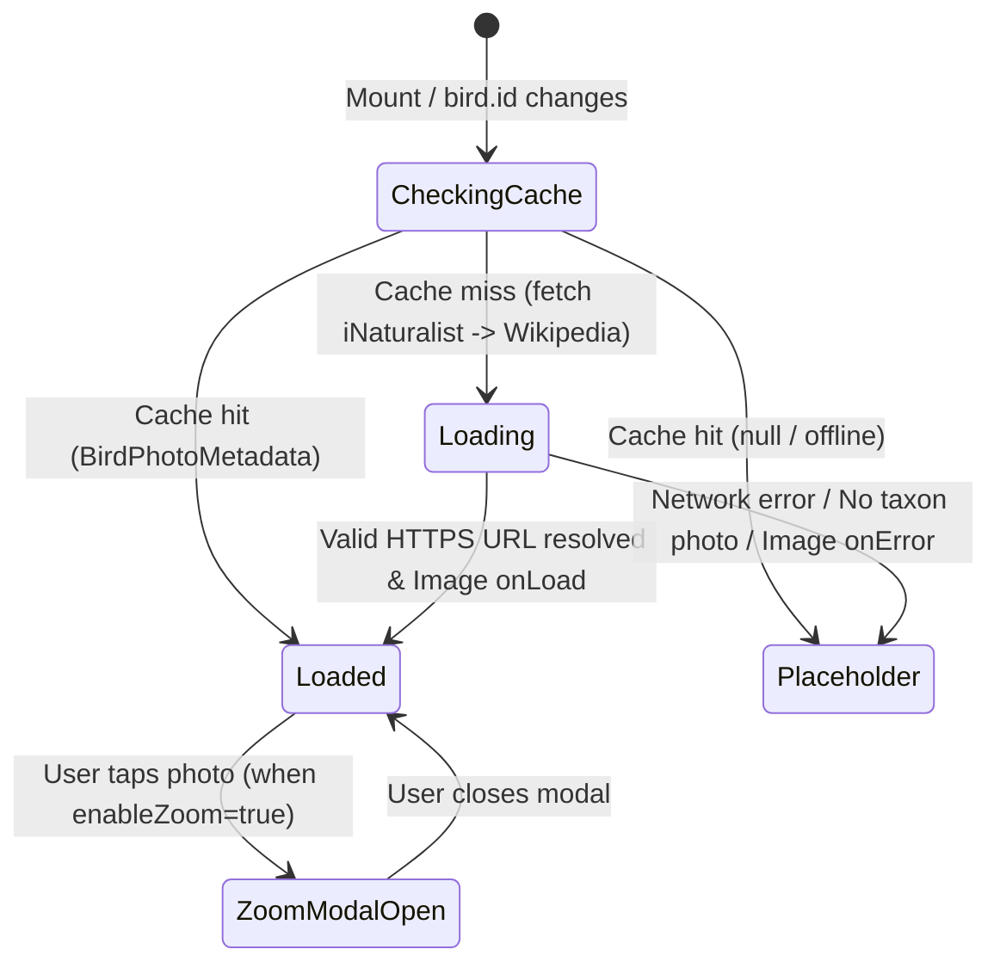

# Phase 1 Data Model: Exibição de Fotografia Real da Ave Junto ao Canto

**Feature Branch**: `002-bird-photo-display`
**Date**: 2026-10-28
**Spec**: [spec.md](file:///home/fpinatti/repos/piapiupiu/specs/002-bird-photo-display/spec.md)

## 1. Entities & TypeScript Interfaces

### 1.1 `BirdCard` (`src/types/bird.ts`)

Extends the existing `BirdCard` interface with an optional pre-resolved `imageUrl` property for backwards-compatible static or dynamic photo resolution.

```ts
export interface BirdCard {
  /** Unique snake_case identifier (e.g., "little_grebe") */
  id: string;
  /** Official Brazilian Portuguese card title (e.g., "Mergulhão-pequeno") */
  name_pt: string;
  /** Official English card title (e.g., "Little Grebe") */
  name_en: string;
  /** Universal binomial scientific name (e.g., "Tachybaptus ruficollis") */
  scientific: string;
  /** Wingspan expansion identifier */
  expansion: ExpansionId;
  /** Habitats where the bird can be played */
  habitats?: HabitatType[];
  /** Reference audio filename */
  audio: string;
  /** Optional recording attribution or source note */
  source?: string;
  /** Optional pre-resolved HTTPS photograph URL from an open biodiversity repository */
  imageUrl?: string;
}
```

---

### 1.2 `BirdPhotoSource` & `BirdPhotoMetadata` (`src/types/bird.ts` / `src/services/birdImageService.ts`)

Represents the resolved photograph URLs and metadata for a given `BirdCard`.

```ts
export type BirdPhotoSource = 'catalog' | 'inaturalist' | 'wikipedia';

export interface BirdPhotoMetadata {
  /** Bird identifier matching BirdCard.id */
  birdId: string;
  /** Optimized HTTPS URL (~300px–500px) for cards, list thumbnails, and mini-player */
  thumbUrl: string;
  /** High-resolution HTTPS URL (~800px–1200px) for the full-screen zoom modal */
  fullUrl: string;
  /** Open data repository that provided the photo */
  source: BirdPhotoSource;
  /** Optional photographer / license attribution string (e.g. "(c) User, CC BY-NC") */
  attribution?: string;
}
```

---

### 1.3 `BirdMediaCache` (In-Memory Session Store in `src/services/birdImageService.ts`)

| Field | Type | Description |
|---|---|---|
| `resolvedCache` | `Map<string, BirdPhotoMetadata \| null>` | Maps `bird.id` to its resolved `BirdPhotoMetadata` (or `null` when both open repositories return no image) so each species is queried at most once per session. |
| `inFlightRequests` | `Map<string, Promise<BirdPhotoMetadata \| null>>` | Deduplicates concurrent calls for the same `bird.id` when multiple components mount simultaneously. |

---

## 2. State Transitions (`<BirdPhoto>` Component)



## 3. Validation Rules

1. **Allowed Protocols**: `thumbUrl` and `fullUrl` MUST use `https:`.
2. **Allowed Hostnames**: Hostname MUST match `static.inaturalist.org`, `inaturalist-open-data.s3.amazonaws.com`, or `upload.wikimedia.org` (or `*.wikimedia.org` / `*.inaturalist.org`).
3. **Taxonomic Lookup Key**:
   - Tier 1: `bird.imageUrl` (if pre-populated and passes `isAllowedImageUrl`).
   - Tier 2: iNaturalist Taxa API queried by `bird.scientific` (exact case-insensitive scientific name match preferred; falls back to `bird.name_en`).
   - Tier 3: Wikipedia REST API `page/summary` queried by `bird.scientific` (then `bird.name_en`).

