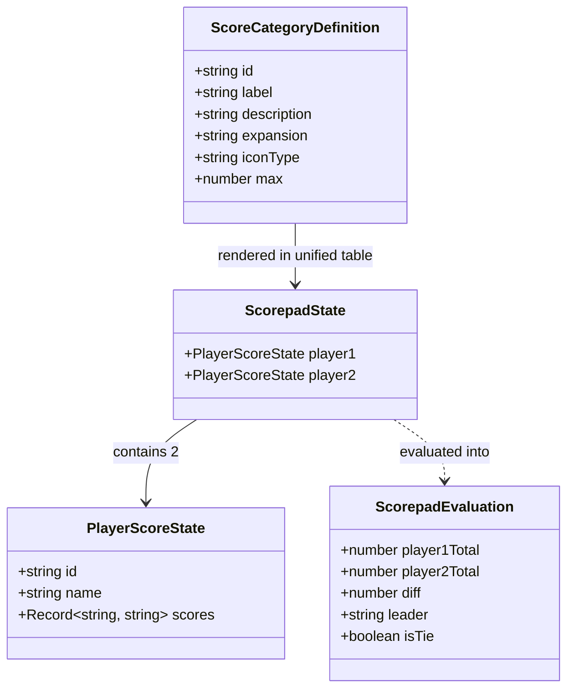

# Data Model: Wingspan Score Pad Calculator (005-score-pad-calculator)

## 1. Entities & Types Overview

---

## 2. Entity Specifications

### 2.1 `ScoreCategoryDefinition`
Represents an official scoring category line item in the Wingspan scorepad.

| Field | Type | Required | Description | Example |
|---|---|---|---|---|
| `id` | `string` | Yes | Unique snake_case identifier | `'birds'`, `'eggs'`, `'nectar'` |
| `label` | `string` | Yes | Display name in Portuguese (PT-BR) | `'Pássaros'`, `'Cartas Bônus'` |
| `description` | `string` | Yes | Brief description of how points are counted | `'Pontos impressos nas cartas de aves baixadas'` |
| `expansion` | `'base' \| 'americas' \| 'oceania'` | Yes | Source set (used for subtle visual tag) | `'base'`, `'americas'`, `'oceania'` |
| `iconType` | `string` | Yes | Semantic visual category icon | `'feather'`, `'egg'`, `'nectar'`, `'goal'` |
| `max` | `number` | No | Maximum permitted value (default: 999) | `999` |

#### Unified Categories Roster (Always Available)

1. **`birds`** (*Pássaros*): `expansion: 'base'`, `iconType: 'feather'` — Sum of bird card face values.
2. **`bonus`** (*Cartas Bônus*): `expansion: 'base'`, `iconType: 'bonus'` — End-game secret bonus card points.
3. **`goals`** (*Metas de Fim de Rodada*): `expansion: 'base'`, `iconType: 'goal'` — Points from the 4 round goal tiles.
4. **`eggs`** (*Ovos*): `expansion: 'base'`, `iconType: 'egg'` — 1 point per egg laid on bird cards.
5. **`food`** (*Comida Estocada*): `expansion: 'base'`, `iconType: 'food'` — 1 point per cached food token on cards.
6. **`tucked`** (*Cartas Sobpostas*): `expansion: 'base'`, `iconType: 'tucked'` — 1 point per card tucked beneath birds.
7. **`hummingbirds`** (*Beija-flores*): `expansion: 'americas'`, `iconType: 'hummingbird'` — Tagged with `[Américas]` badge. Optional; leave blank if unused.
8. **`nectar`** (*Néctar*): `expansion: 'oceania'`, `iconType: 'nectar'` — Tagged with `[Oceania]` badge. Optional; leave blank if unused.

---

### 2.2 `PlayerScoreState`
Represents the interactive input state for a single player column.

| Field | Type | Required | Description | Constraints |
|---|---|---|---|---|
| `id` | `'player1' \| 'player2'` | Yes | Player identifier | Immutable column key |
| `name` | `string` | Yes | Player display name | Max 24 chars, default `'Jogador 1'` / `'Jogador 2'` |
| `scores` | `Record<string, string>` | Yes | Map of category ID to raw user string input | String of digits `0..999` or empty `""` |

---

### 2.3 `ScorepadState`
Top-level state for the interactive scoring session.

| Field | Type | Required | Description |
|---|---|---|---|
| `player1` | `PlayerScoreState` | Yes | State for Player 1 |
| `player2` | `PlayerScoreState` | Yes | State for Player 2 |

---

### 2.4 `ScorepadEvaluation`
Derived pure calculation result computed instantaneously on any state modification.

| Field | Type | Description |
|---|---|---|
| `player1Total` | `number` | Computed sum of Player 1's points across all categories |
| `player2Total` | `number` | Computed sum of Player 2's points across all categories |
| `diff` | `number` | Absolute score difference between players (`Math.abs(p1 - p2)`) |
| `leader` | `'player1' \| 'player2' \| 'tie' \| 'none'` | Identifies current leader or tie |
| `isTie` | `boolean` | `true` if `player1Total === player2Total` and total > 0 |

---

## 3. Validation & Sanitization Rules

1. **Numeric Category Values**:
   - Accepts only numeric characters `0-9`.
   - Strips any non-digit character (`text.replace(/[^0-9]/g, '')`).
   - Caps input length at 3 digits (`.slice(0, 3)`), yielding numbers `0` to `999`.
   - Empty input `""` is valid during typing and safely evaluated as `0`.
2. **Player Names**:
   - Trimmed string with maximum 24 characters (`name.trim().slice(0, 24)`).
   - If left empty upon blur, falls back to default (`"Jogador 1"` / `"Jogador 2"`).
3. **Unified Calculation**:
   - Summation iterates over all categories in the scorepad.
   - Any unplayed expansion field left empty adds `0` points, with no setup modal or version configuration required.
