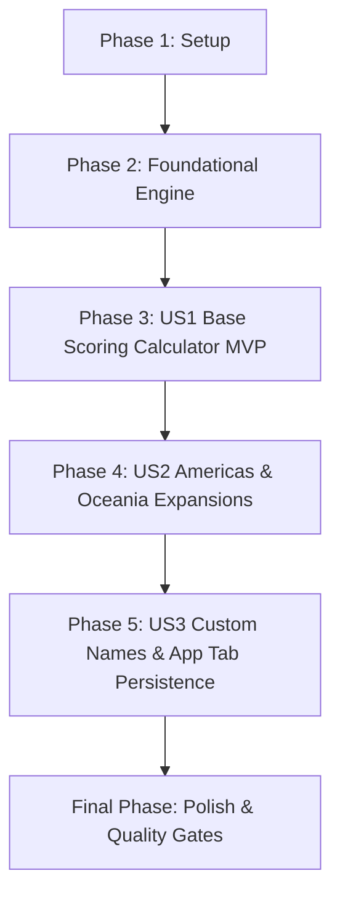

# Tasks: Wingspan Score Pad Calculator (005-score-pad-calculator)

**Input**: Design documents from `/specs/005-score-pad-calculator/` (`plan.md`, `spec.md`, `research.md`, `data-model.md`, `contracts/scorepad-contract.ts`, `quickstart.md`)

**Prerequisites**: `plan.md` (complete), `spec.md` (complete), `data-model.md` (complete), `contracts/` (complete)

**Organization**: Tasks are grouped by user story to enable independent implementation and testing of each story.

## Format: `- [ ] [ID] [P?] [Story?] Description with file path`

- **[P]**: Can run in parallel (different files, no dependencies)
- **[Story]**: Which user story this task belongs to (`[US1]`, `[US2]`, `[US3]`)
- Every task includes explicit file paths

---

## Phase 1: Setup (Shared Infrastructure)

**Purpose**: Shared types, models, and constant seeds for the scorepad domain.

- [X] T001 Create shared TypeScript definitions for scorepad categories, versions, and player state in src/types/scorepad.ts
- [X] T002 [P] Create scorepad constant seeds and category metadata definitions in src/types/scorepad.ts

---

## Phase 2: Foundational (Blocking Prerequisites)

**Purpose**: Core calculation, validation, sanitization, and evaluation logic with automated tests.

**⚠️ CRITICAL**: All foundational arithmetic and sanitization logic must be tested and passing before UI assembly.

- [X] T003 [P] Implement input sanitization and string-to-number parser functions in src/utils/scoreCalculator.ts
- [X] T004 [P] Implement unit tests for sanitization and number parsing in src/__tests__/scoreCalculator.test.ts
- [X] T005 Implement active categories resolver and player sum calculation engine in src/utils/scoreCalculator.ts
- [X] T006 Implement winner, tie, and score difference evaluation logic in src/utils/scoreCalculator.ts
- [X] T007 Implement unit tests for active categories, player summation, and winner evaluation in src/__tests__/scoreCalculator.test.ts

**Checkpoint**: Core domain engine ready and 100% test-verified.

---

## Phase 3: User Story 1 - Two-Player Interactive Scoring Calculator (Priority: P1) 🎯 MVP

**Goal**: Deliver a functional 2-player scorepad tallying the 6 standard base game categories in real time with immediate winner detection.

**Independent Test**: Enter numbers in Player 1 and Player 2 columns for base categories; verify that column totals and winner highlights update instantaneously without perceptual lag.

### Implementation for User Story 1

- [X] T008 [US1] Create base two-player scorepad screen component layout and state in src/screens/ScorepadScreen.tsx
- [X] T009 [US1] Implement real-time numeric inputs with number-pad keyboard for the 6 core categories in src/screens/ScorepadScreen.tsx
- [X] T010 [US1] Implement real-time total score header and winner banner with tie indicators in src/screens/ScorepadScreen.tsx
- [X] T011 [US1] Apply Naturalist Field Guide theme styling (linen paper, borders, watercolor badges) in src/screens/ScorepadScreen.tsx

**Checkpoint**: User Story 1 provides a fully functional, self-contained 2-player base game scoring calculator (MVP).

---

## Phase 4: User Story 2 - Expansion Scorepad Modes (Americas & Oceania) (Priority: P2)

**Goal**: Support expansion scoring modes by adding dedicated rows (Beija-flores for Americas, Néctar for Oceania) while preserving entered values across version changes.

**Independent Test**: Toggle between "Jogo Base", "Américas", and "Oceania" versions; verify that expansion categories appear/disappear dynamically and contribute accurately to total points while shared values remain intact.

### Implementation for User Story 2

- [X] T012 [US2] Implement expansion version selector chips (Jogo Base, Américas, Oceania) in src/screens/ScorepadScreen.tsx
- [X] T013 [US2] Integrate dynamic Americas Beija-flores category row into the scorepad input table in src/screens/ScorepadScreen.tsx
- [X] T014 [US2] Integrate dynamic Oceania Néctar category row into the scorepad input table in src/screens/ScorepadScreen.tsx
- [X] T015 [US2] Add unit tests verifying expansion category filtering and preservation across version switches in src/__tests__/scoreCalculator.test.ts

**Checkpoint**: User Stories 1 and 2 work seamlessly across all official Wingspan scoring editions.

---

## Phase 5: User Story 3 - Custom Player Names, Clear Action & Tab Session Persistence (Priority: P3)

**Goal**: Allow players to personalize column headers with custom names, quickly reset scores for a new game, and maintain score sheet state when navigating between app tabs.

**Independent Test**: Change player names to custom text, switch to the Catalog tab and back to Scorepad to confirm state retention, and tap "Novo Jogo" to verify reset confirmation.

### Implementation for User Story 3

- [X] T016 [US3] Implement inline editable player name text inputs with 24-character limit and defaults in src/screens/ScorepadScreen.tsx
- [X] T017 [US3] Implement "Novo Jogo" reset action with confirmation dialog clearing all inputs in src/screens/ScorepadScreen.tsx
- [X] T018 [US3] Integrate "Pontuação" tab into bottom navigation bar and wire persistent scorepad state in App.tsx

**Checkpoint**: Full end-to-end integration complete across all 3 user stories.

---

## Final Phase: Polish & Cross-Cutting Concerns

**Purpose**: Quality assurance, type safety verification, and execution of test scenarios.

- [X] T019 [P] Verify end-to-end scenarios per quickstart guide in specs/005-score-pad-calculator/quickstart.md
- [X] T020 [P] Run TypeScript compiler checks and ensure zero type errors across the codebase using npm run typecheck
- [X] T021 Run complete Jest test suites and verify all tests pass using npm test

---

## Dependencies & Execution Order

### Phase Dependencies

- **Setup (Phase 1)**: No dependencies - can start immediately.
- **Foundational (Phase 2)**: Depends on Phase 1 types; BLOCKS all UI user stories.
- **User Story 1 (Phase 3 - P1)**: Depends on Foundational completion. Delivers MVP.
- **User Story 2 (Phase 4 - P2)**: Depends on User Story 1. Adds expansion scoring rows.
- **User Story 3 (Phase 5 - P3)**: Depends on User Story 1 & 2. Adds personalization, reset, and tab persistence.
- **Polish (Final Phase)**: Runs after all user stories are complete.

### User Story Dependencies



---

## Parallel Execution Examples

### Parallel Opportunities in Foundational Phase (Phase 2)
```bash
# Developer A / Subagent 1: Implement sanitization & parser logic
Task: "Implement input sanitization and string-to-number parser functions in src/utils/scoreCalculator.ts"

# Developer B / Subagent 2: Author corresponding unit tests
Task: "Implement unit tests for sanitization and number parsing in src/__tests__/scoreCalculator.test.ts"
```

### Parallel Opportunities in Final Phase
```bash
# Run verification and type checks in parallel
Task: "Verify end-to-end scenarios per quickstart guide in specs/005-score-pad-calculator/quickstart.md"
Task: "Run TypeScript compiler checks and ensure zero type errors across the codebase using npm run typecheck"
```

---

## Implementation Strategy

### MVP First (User Story 1 Only)
1. Complete Phase 1 (Setup) and Phase 2 (Foundational Engine + Tests).
2. Complete Phase 3 (US1 Base Calculator).
3. **STOP and VALIDATE**: Test 2-player base game tallying on device/web.

### Incremental Delivery
1. Foundation + US1 → Base 2-player scorepad operational.
2. US2 → Expansion support (Hummingbirds & Nectar).
3. US3 → Personalization, game reset, and seamless bottom tab persistence.
4. Polish → Zero-defect verification, 100% test pass rate.

