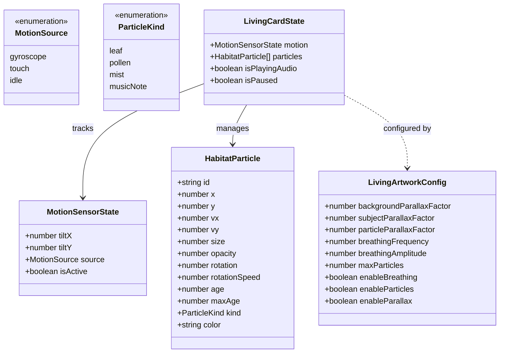
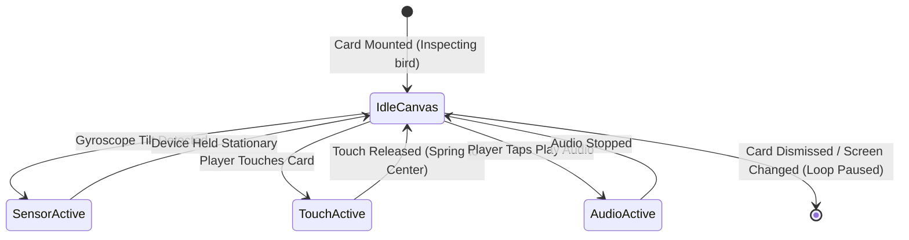

# Data Model: Living 2D Bird Artwork with React Native Skia (006-skia-bird-motion)

## 1. Entities & Types Overview

---

## 2. Entity Specifications

### 2.1 `MotionSensorState`
Represents the current real-time angular orientation or touch offset of the card.

| Field | Type | Required | Description | Constraints |
|---|---|---|---|---|
| `tiltX` | `number` | Yes | Normalized horizontal tilt (-1.0 to 1.0) | Clamped to `[-1.0, 1.0]` |
| `tiltY` | `number` | Yes | Normalized vertical tilt (-1.0 to 1.0) | Clamped to `[-1.0, 1.0]` |
| `source` | `'gyroscope' \| 'touch' \| 'idle'` | Yes | Source driving the motion | Default `'idle'` |
| `isActive` | `boolean` | Yes | Whether the user is actively tilting or touching | Boolean |

---

### 2.2 `HabitatParticle`
Represents a single atmospheric particle living in the card's environment.

| Field | Type | Required | Description | Example |
|---|---|---|---|---|
| `id` | `string` | Yes | Unique particle identifier | `'p_14'` |
| `x` | `number` | Yes | Horizontal coordinate on card canvas | `120.5` |
| `y` | `number` | Yes | Vertical coordinate on card canvas | `45.2` |
| `vx` | `number` | Yes | Horizontal velocity per frame | `0.4` |
| `vy` | `number` | Yes | Vertical velocity per frame | `0.8` |
| `size` | `number` | Yes | Particle radius or bounding size in px | `6.0` |
| `opacity` | `number` | Yes | Alpha transparency (0.0 to 1.0) | `0.65` |
| `rotation` | `number` | Yes | Rotation angle in radians | `1.24` |
| `rotationSpeed` | `number` | Yes | Angular velocity per frame | `0.02` |
| `age` | `number` | Yes | Current lifespan in frames | `45` |
| `maxAge` | `number` | Yes | Total lifespan before recycling | `180` |
| `kind` | `ParticleKind` | Yes | Particle visual type | `'leaf'`, `'pollen'`, `'mist'`, `'musicNote'` |
| `color` | `string` | Yes | Primary hex or rgba color | `'rgba(62, 107, 79, 0.7)'` |

---

### 2.3 `LivingArtworkConfig`
Defines operational constants and tuning parameters for the animation shaders and physics.

| Parameter | Type | Default | Description |
|---|---|---|---|
| `backgroundParallaxFactor` | `number` | `0.35` | Multiplier for background watercolor wash translation |
| `subjectParallaxFactor` | `number` | `1.00` | Multiplier for foreground bird subject translation |
| `particleParallaxFactor` | `number` | `1.45` | Multiplier for foreground atmospheric particles |
| `breathingFrequency` | `number` | `0.28` | Breathing oscillation cycle in Hz (~3.5s per breath) |
| `breathingAmplitude` | `number` | `2.5` | Maximum vertex displacement in pixels |
| `maxParticles` | `number` | `16` | Maximum concurrent particles on the canvas |
| `enableBreathing` | `boolean` | `true` | Toggle for SkSL breathing shader |
| `enableParticles` | `boolean` | `true` | Toggle for particle emission |
| `enableParallax` | `boolean` | `true` | Toggle for 2.5D optical tilt |

---

## 3. State Lifecycle & Transitions

