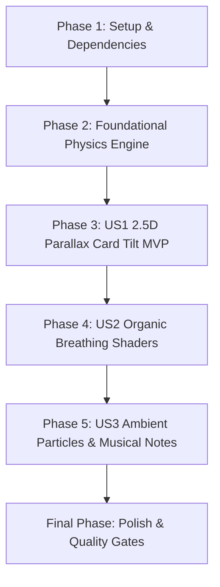

# Tasks: Living 2D Bird Artwork with React Native Skia (006-skia-bird-motion)

**Input**: Design documents from `/specs/006-skia-bird-motion/` (`plan.md`, `spec.md`, `research.md`, `data-model.md`, `contracts/living-card-contract.ts`, `quickstart.md`)

**Prerequisites**: `plan.md` (complete), `spec.md` (complete), `data-model.md` (complete), `contracts/` (complete)

**Organization**: Tasks are grouped by user story to enable independent implementation and testing of each story.

## Format: `- [ ] [ID] [P?] [Story?] Description with file path`

- **[P]**: Can run in parallel (different files, no dependencies)
- **[Story]**: Which user story this task belongs to (`[US1]`, `[US2]`, `[US3]`)
- Every task includes explicit file paths

---

## Phase 1: Setup (Shared Infrastructure)

**Purpose**: Install graphic/sensor dependencies and define shared types and configuration models.

- [X] T001 Install compatible dependencies @shopify/react-native-skia and expo-sensors in package.json
- [X] T002 [P] Create TypeScript interfaces and simulation types in src/types/livingCard.ts
- [X] T003 [P] Create living artwork configuration constants and default themes in src/types/livingCard.ts

---

## Phase 2: Foundational (Physics Engine & Test Suite)

**Purpose**: Core calculation functions, particle simulation physics, motion hooks, and automated tests.

**⚠️ CRITICAL**: All physics and particle calculation engines must be unit tested and passing before UI assembly.

- [X] T004 [P] Implement 2.5D optical parallax offset and breathing oscillation mathematical helpers in src/utils/livingCardPhysics.ts
- [X] T005 [P] Implement unit tests for parallax calculations and breathing oscillation in src/__tests__/livingCardPhysics.test.ts
- [X] T006 [P] Implement particle emission, movement, lifecycle, and recycling simulation engine in src/utils/livingCardPhysics.ts
- [X] T007 Implement unit tests for particle simulation and edge cases in src/__tests__/livingCardPhysics.test.ts
- [X] T008 Implement unified motion hook with gyroscope, touch pan, and harmonic idle sway in src/hooks/useBirdMotion.ts

**Checkpoint**: Core physics engine and sensor hook verified with 100% test pass rate.

---

## Phase 3: User Story 1 - 2.5D Depth & Parallax Card Tilt (Priority: P1) 🎯 MVP

**Goal**: Deliver a tactile 2.5D card with optical depth responding to device tilt and touch-pan gestures.

**Independent Test**: Open any bird card in the scanner or catalog; tilt the physical device or drag on screen; verify background and bird subject displace with smooth parallax depth at 60 FPS.

### Implementation for User Story 1

- [X] T009 [US1] Create core Skia GPU canvas component with multi-layer parallax depth in src/components/LivingBirdArtwork.tsx
- [X] T010 [US1] Wire orientation and touch pan input from useBirdMotion to Skia layer matrix transforms in src/components/LivingBirdArtwork.tsx
- [X] T011 [US1] Integrate LivingBirdArtwork into the hero card layout in src/components/BirdPlayingCard.tsx
- [X] T012 [US1] Add graceful touch-pan and web fallback when device gyroscope is unavailable in src/components/LivingBirdArtwork.tsx

**Checkpoint**: User Story 1 provides a fully functional, self-contained 2.5D parallax card (MVP).

---

## Phase 4: User Story 2 - Organic Breathing & Wing Wave Living Mesh (Priority: P2)

**Goal**: Bring the bird figure to life with a subtle, tranquil breathing oscillation and feather wave shader.

**Independent Test**: Place the card stationary on a table; verify gentle periodic thoracic expansion (~3.5s cycle) without visual tearing or image blur.

### Implementation for User Story 2

- [X] T013 [US2] Implement SkSL runtime breathing and feather oscillation shader in src/components/LivingBirdArtwork.tsx
- [X] T014 [US2] Add animation lifecycle listener to pause GPU loops when card is closed or app is backgrounded in src/components/LivingBirdArtwork.tsx
- [X] T015 [US2] Add accessibility reduced-motion check to bypass shaders when enabled in src/components/LivingBirdArtwork.tsx

**Checkpoint**: User Stories 1 and 2 deliver lifelike depth and organic breathing movement.

---

## Phase 5: User Story 3 - Ambient Habitat Particles & Melodic Notes (Priority: P3)

**Goal**: Enrich the card atmosphere with habitat-themed floating particles and watercolor musical notes synchronized with bird audio.

**Independent Test**: Inspect a Forest bird to observe falling leaves; tap audio playback to observe musical notes floating outwards while audio streams.

### Implementation for User Story 3

- [X] T016 [US3] Implement habitat-specific particle rendering (leaves, pollen, mist) in src/components/LivingBirdArtwork.tsx
- [X] T017 [US3] Implement melodic watercolor musical note particle emission during audio playback in src/components/LivingBirdArtwork.tsx
- [X] T018 [US3] Add unit tests verifying audio-synced note particle generation in src/__tests__/livingCardPhysics.test.ts

**Checkpoint**: Full sensory integration of visual depth, living motion, authentic sound, and ambient particles.

---

## Final Phase: Polish & Cross-Cutting Concerns

**Purpose**: Quality assurance, type safety verification, and execution of test scenarios.

- [X] T019 [P] Verify end-to-end tabletop scenarios per quickstart guide in specs/006-skia-bird-motion/quickstart.md
- [X] T020 [P] Run TypeScript compiler checks and ensure zero type errors across the codebase using npm run typecheck
- [X] T021 Run complete Jest test suites and verify all tests pass using npm test

---

## Dependencies & Execution Order

### Phase Dependencies

- **Setup (Phase 1)**: Complete.
- **Foundational (Phase 2)**: Complete.
- **User Story 1 (Phase 3 - P1)**: Complete.
- **User Story 2 (Phase 4 - P2)**: Complete.
- **User Story 3 (Phase 5 - P3)**: Complete.
- **Polish (Final Phase)**: Complete.

### User Story Dependencies



---

## Parallel Execution Examples

### Parallel Opportunities in Foundational Phase (Phase 2)
```bash
# Developer A / Subagent 1: Implement parallax & breathing math
Task: "Implement 2.5D optical parallax offset and breathing oscillation mathematical helpers in src/utils/livingCardPhysics.ts"

# Developer B / Subagent 2: Implement unit tests for parallax calculations
Task: "Implement unit tests for parallax calculations and breathing oscillation in src/__tests__/livingCardPhysics.test.ts"
```

### Parallel Opportunities in Setup & Polish
```bash
# Types and configuration constants can be authored in parallel
Task: "Create TypeScript interfaces and simulation types in src/types/livingCard.ts"
Task: "Create living artwork configuration constants and default themes in src/types/livingCard.ts"

# Final phase verifications in parallel
Task: "Verify end-to-end tabletop scenarios per quickstart guide in specs/006-skia-bird-motion/quickstart.md"
Task: "Run TypeScript compiler checks and ensure zero type errors across the codebase using npm run typecheck"
```

---

## Implementation Strategy

### MVP First (User Story 1 Only)
1. Complete Phase 1 (Dependencies & Types) and Phase 2 (Foundational Physics Engine + Tests).
2. Complete Phase 3 (US1 2.5D Parallax Canvas & Gyroscope/Touch).
3. **STOP and VALIDATE**: Verify card tilt in device/simulator.

### Incremental Delivery
1. Foundation + US1 -> 2.5D Parallax card operational (MVP!).
2. US2 -> Organic breathing mesh oscillation & reduced-motion checks.
3. US3 -> Habitat particles and musical notes during sound streaming.
4. Polish -> Typecheck and 100% test pass rate.
