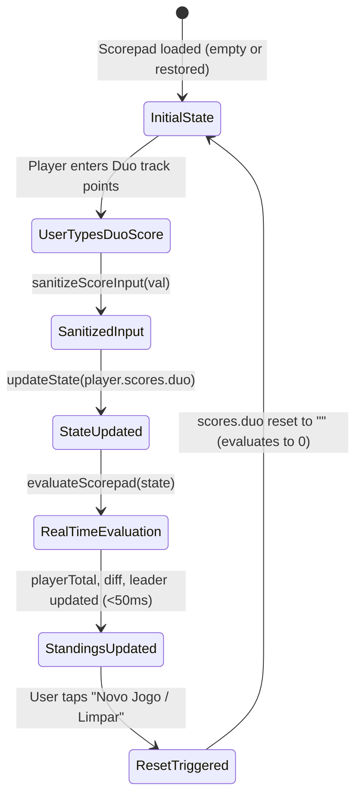

# Data Model: Wingspan Scorepad Asia Duo Mode Track Scoring

**Feature**: `008-scorepad-asia-duo-mode`
**Date**: 2026-11-01
**Status**: Completed

## 1. Entity Definitions & Types

### 1.1 `ScoreCategoryDefinition`
Represents a row in the unified scorepad table.

```typescript
export type ScorepadExpansionId = 'base' | 'americas' | 'oceania' | 'asia';

export type ScoreCategoryIconType =
  | 'feather'
  | 'bonus'
  | 'goal'
  | 'egg'
  | 'food'
  | 'tucked'
  | 'hummingbird'
  | 'nectar'
  | 'duo';

export interface ScoreCategoryDefinition {
  readonly id: string;
  readonly label: string;
  readonly description: string;
  readonly expansion: ScorepadExpansionId;
  readonly iconType: ScoreCategoryIconType;
  readonly max?: number;
}
```

### 1.2 Asia Duo Category Record
The seed definition appended to `DEFAULT_SCORE_CATEGORIES`:

```typescript
{
  id: 'duo',
  label: 'Modo Duo',
  description: 'Pontos do maior grupo de fichas conectadas no tabuleiro de Duo (Ásia)',
  expansion: 'asia',
  iconType: 'duo',
}
```

### 1.3 `ScorepadVersionDefinition`
Version metadata definition for `SCOREPAD_VERSIONS`:

```typescript
export type ScorepadVersionId = 'base' | 'americas' | 'oceania' | 'asia';

export interface ScorepadVersionDefinition {
  readonly id: ScorepadVersionId;
  readonly label: string;
  readonly subtitle: string;
}
```

Asia Version Record:
```typescript
{
  id: 'asia',
  label: 'Ásia',
  subtitle: 'Com pontuação do Modo Duo',
}
```

### 1.4 `PlayerScoreState` & `ScorepadState`
Unchanged structural shape; now supports the `'duo'` key in `scores`:

```typescript
export interface PlayerScoreState {
  readonly id: 'player1' | 'player2';
  name: string;
  scores: Record<string, string>; // e.g. { birds: "35", duo: "11", ... }
}

export interface ScorepadState {
  version?: ScorepadVersionId;
  player1: PlayerScoreState;
  player2: PlayerScoreState;
}
```

---

## 2. Validation & Normalization Rules

| Field | Rule | Default / Fallback |
|-------|------|--------------------|
| `scores.duo` input | Only numeric digits `[0-9]`, max 3 characters (`0..999`) | `""` |
| `scores.duo` parsed | Evaluated as non-negative integer via `parseInt(input, 10)` | `0` when empty or undefined |
| Leading zeroes | Stripped unless single `"0"` (e.g. `"07"` $\to$ `"7"`, `"0"` $\to$ `"0"`) | `"0"` |

---

## 3. Scorepad State Lifecycle & Evaluation



